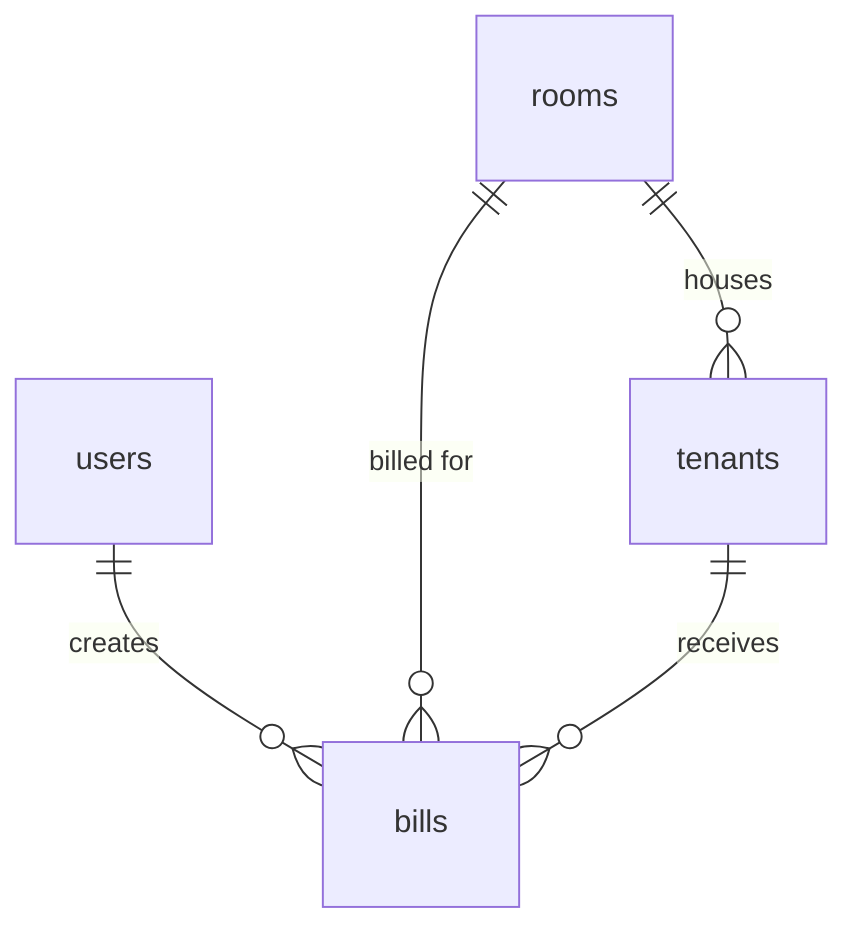

# ระบบจัดการหอพักและคำนวณบิลค่าเช่าออนไลน์

โปรเจกต์วิชา Database Management มหาวิทยาลัยบูรพา
เว็บแอปให้เจ้าของหอจัดการห้องพัก ผู้เช่า และคำนวณบิลค่าน้ำค่าไฟประจำเดือน
เขียนด้วย Native PHP + MySQLi (Prepared Statements) และ Bootstrap 5

## ฟีเจอร์ที่ทำแล้ว

- [x] Login / Logout ด้วย Session, `password_hash()` และ `password_verify()`
- [x] ป้องกันหน้าที่ต้องล็อกอิน (`includes/auth.php`)
- [x] CRUD ห้องพัก: ดูผังห้องตามชั้น ค้นหา กรองสถานะ เพิ่ม แก้ไข ลบ
- [x] CSRF Token ในทุกฟอร์มที่เปลี่ยนข้อมูล
- [ ] CRUD ผู้เช่า
- [ ] จดมิเตอร์และคำนวณบิลประจำเดือน
- [ ] หน้าภาพรวม (Dashboard)

## ติดตั้งบนเครื่อง (XAMPP)

1. วางโฟลเดอร์โปรเจกต์ไว้ใน `C:\xampp\htdocs\dorm`
2. เปิด XAMPP Control Panel แล้ว Start **Apache** และ **MySQL**
3. เข้า `http://localhost/phpmyadmin` > แท็บ SQL > วางเนื้อหาไฟล์ `database/setup.sql` > Go
4. คัดลอก `config/db.example.php` เป็น `config/db.php` แล้วแก้รหัสผ่าน MySQL ถ้าเครื่องตั้งไว้
5. เข้า `http://localhost/dorm/`

ต้องใช้ PHP 8.0 ขึ้นไป (XAMPP รุ่นปัจจุบันใช้ได้)

## วิธีทดลองใช้

บัญชีทดสอบ: `admin@dorm.com` / `password123`

| ทดสอบ | ผลที่ควรได้ |
| --- | --- |
| ล็อกอินด้วยรหัสถูก | เข้าหน้าห้องพัก เห็นผัง 18 ห้อง |
| ล็อกอินด้วยรหัสผิด | มีกล่องแจ้ง "อีเมลหรือรหัสผ่านไม่ถูกต้อง" |
| ออกจากระบบ แล้วเปิด `rooms.php` ตรง ๆ | ถูกส่งกลับไปหน้า login |
| เพิ่มห้อง 107 | ห้อง 107 ปรากฏในชั้น 1 |
| เพิ่มห้อง 101 ซ้ำ | แจ้ง "มีห้อง 101 อยู่แล้ว" |
| ลบห้องที่มีผู้เช่าหรือบิล (เช่น 101) | ลบไม่ได้ พร้อมบอกเหตุผล |
| ลบห้องที่ไม่เคยมีผู้เช่า (เช่น 102) | ลบได้หลังกดยืนยัน |

## โครงสร้างไฟล์

```
config/db.php            การเชื่อมต่อฐานข้อมูล (ไม่ push ขึ้น GitHub)
config/db.example.php    ไฟล์ตัวอย่างสำหรับคัดลอก
database/setup.sql       สร้างตาราง users, rooms, tenants, bills + ข้อมูลตัวอย่าง
includes/                auth, ฟังก์ชันช่วย, ส่วนหัว/ท้ายหน้า, ฟอร์มห้อง
assets/css/app.css       ธีมหน้าตาของระบบ
login.php / logout.php   ระบบยืนยันตัวตน
rooms.php                รายการห้อง (READ)
room_view.php            รายละเอียดห้อง (READ)
room_create.php          เพิ่มห้อง (CREATE)
room_edit.php            แก้ไขห้อง (UPDATE)
room_delete.php          ลบห้อง (DELETE)
preview/                 ต้นแบบหน้าจอด้วยข้อมูลตัวอย่าง (ไม่เชื่อมฐานข้อมูล)
```

## ER Diagram


