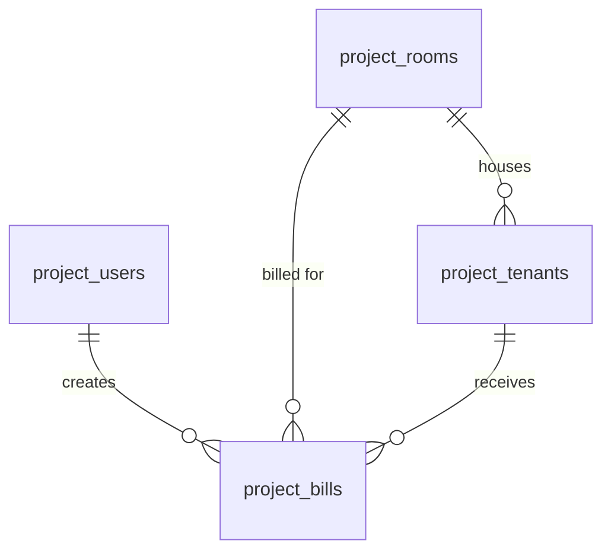

# ระบบจัดการหอพักและคำนวณบิลค่าเช่าออนไลน์

โปรเจกต์วิชา Database Management มหาวิทยาลัยบูรพา
เว็บแอปให้เจ้าของหอจัดการห้องพัก ผู้เช่า และคำนวณบิลค่าน้ำค่าไฟประจำเดือน
เขียนด้วย Native PHP + MySQLi (Prepared Statements) และ Bootstrap 5

## ฟีเจอร์

- [x] Login / Logout ด้วย Session, `password_hash()` และ `password_verify()`
- [x] ป้องกันทุกหน้าที่ต้องล็อกอิน (`includes/auth.php`) และ CSRF Token ในทุกฟอร์มที่เปลี่ยนข้อมูล
- [x] ภาพรวม: จำนวนห้องแต่ละสถานะ ผังห้องตามชั้น รายการค้างชำระ ความคืบหน้าการจดมิเตอร์
- [x] CRUD ห้องพัก: ค้นหา กรองสถานะ เพิ่ม แก้ไข ลบ (ลบไม่ได้ถ้ามีประวัติ)
- [x] CRUD ผู้เช่า: เพิ่มเข้าห้องว่าง แก้ไข บันทึกย้ายออก ลบ (ลบได้เฉพาะคนที่ยังไม่มีบิล)
- [x] จดมิเตอร์และบิล: ดึงเลขเดือนก่อนอัตโนมัติ คำนวณตามมิเตอร์หรือเหมาจ่าย บันทึกชำระ แก้ไข ลบ พิมพ์ใบแจ้งค่าเช่า

อัตราค่าน้ำค่าไฟตั้งไว้ที่ `includes/settings.php` (ไฟ 8 บาท/หน่วย, น้ำ 18 บาท/หน่วย, น้ำเหมาจ่าย 150 บาท/เดือน)
บิลที่ยังไม่ชำระของเดือนก่อน ๆ นับเป็น "ค้างชำระ" ส่วนบิลเดือนปัจจุบันนับเป็น "รอชำระ"

## ติดตั้งบนเครื่อง (XAMPP)

1. วางโฟลเดอร์โปรเจกต์ไว้ใน `C:\xampp\htdocs\dorm`
2. เปิด XAMPP Control Panel แล้ว Start **Apache** และ **MySQL**
3. เข้า `http://localhost/phpmyadmin` > แท็บ SQL > วางเนื้อหาไฟล์ `database/setup.sql` > Go
4. คัดลอก `config/db.example.php` เป็น `config/db.php` แล้วแก้รหัสผ่าน MySQL ถ้าเครื่องตั้งไว้
5. เข้า `http://localhost/dorm/`

ต้องใช้ PHP 8.0 ขึ้นไป (XAMPP รุ่นปัจจุบันใช้ได้)

## วิธีทดลองใช้

บัญชีทดสอบ: `admin@dorm.com` / `password123`

| ทดสอบ | ผลที่ควรได้ |
| --- | --- |
| ล็อกอินด้วยรหัสถูก | เข้าหน้าห้องพัก เห็นผัง 18 ห้อง |
| ล็อกอินด้วยรหัสผิด | มีกล่องแจ้ง "อีเมลหรือรหัสผ่านไม่ถูกต้อง" |
| ออกจากระบบ แล้วเปิด `rooms.php` ตรง ๆ | ถูกส่งกลับไปหน้า login |
| เพิ่มห้อง 107 | ห้อง 107 ปรากฏในชั้น 1 |
| เพิ่มห้อง 101 ซ้ำ | แจ้ง "มีห้อง 101 อยู่แล้ว" |
| ลบห้องที่มีผู้เช่าหรือบิล (เช่น 101) | ลบไม่ได้ พร้อมบอกเหตุผล |
| ลบห้องที่ไม่เคยมีผู้เช่า (เช่น 102) | ลบได้หลังกดยืนยัน |
| เพิ่มผู้เช่าเข้าห้อง 102 | ห้อง 102 เปลี่ยนเป็น "มีผู้เช่า" |
| จดมิเตอร์ห้อง 101 เดือนปัจจุบัน | เลขเดือนก่อนขึ้นมาให้เอง (ไฟ 8,105) |
| กรอกเลขมิเตอร์น้อยกว่าเดือนก่อน | แจ้ง "ต้องไม่น้อยกว่าเลขเดือนก่อน" |
| จดมิเตอร์ห้องเดิมซ้ำในเดือนเดียวกัน | ระบบพาไปที่บิลที่มีอยู่แล้ว |
| กด "บันทึกว่าชำระแล้ว" ที่บิลค้างของห้อง 302 | ห้อง 302 หายจากรายการค้างชำระในหน้าภาพรวม |
| บันทึกย้ายออกผู้เช่า | ห้องกลับเป็น "ว่าง" ผู้เช่าย้ายไปอยู่กลุ่ม "ย้ายออกแล้ว" |

## โครงสร้างไฟล์

```
config/db.php            การเชื่อมต่อฐานข้อมูล (ไม่ push ขึ้น GitHub)
config/db.example.php    ไฟล์ตัวอย่างสำหรับคัดลอก
database/setup.sql        สร้างตาราง project_users, project_rooms, project_tenants, project_bills (XAMPP)
database/setup_server.sql เวอร์ชันสำหรับเซิร์ฟเวอร์ Angsila (ฐานข้อมูล s68160390)
includes/                auth, ฟังก์ชันช่วย, ส่วนหัว/ท้ายหน้า, ฟอร์มห้อง
assets/css/app.css       ธีมหน้าตาของระบบ
login.php / logout.php   ระบบยืนยันตัวตน
dashboard.php            หน้าภาพรวม
rooms.php, room_*.php    CRUD ห้องพัก
tenants.php, tenant_*.php CRUD ผู้เช่า (tenant_moveout.php = บันทึกย้ายออก)
bills.php, bill_*.php    จดมิเตอร์และบิล (bill_action.php = ชำระ/ยกเลิก/ลบ)
includes/settings.php    อัตราค่าน้ำค่าไฟ
preview/                 ต้นแบบหน้าจอด้วยข้อมูลตัวอย่าง (ไม่เชื่อมฐานข้อมูล)
```

## ER Diagram


